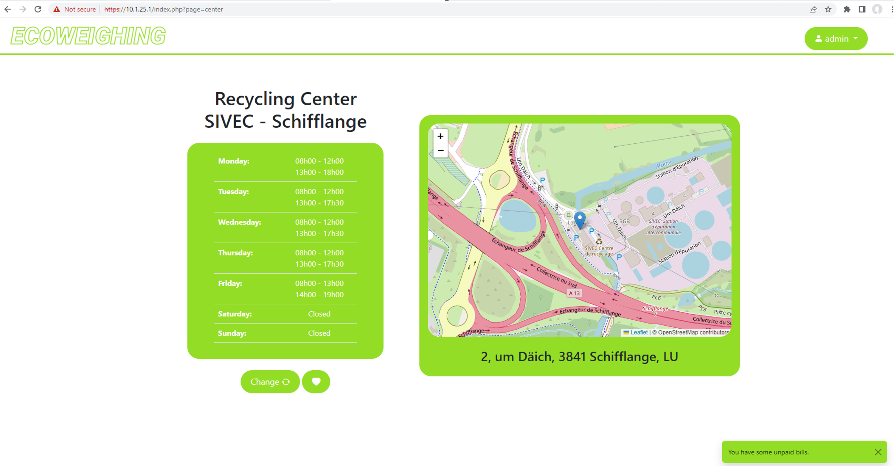
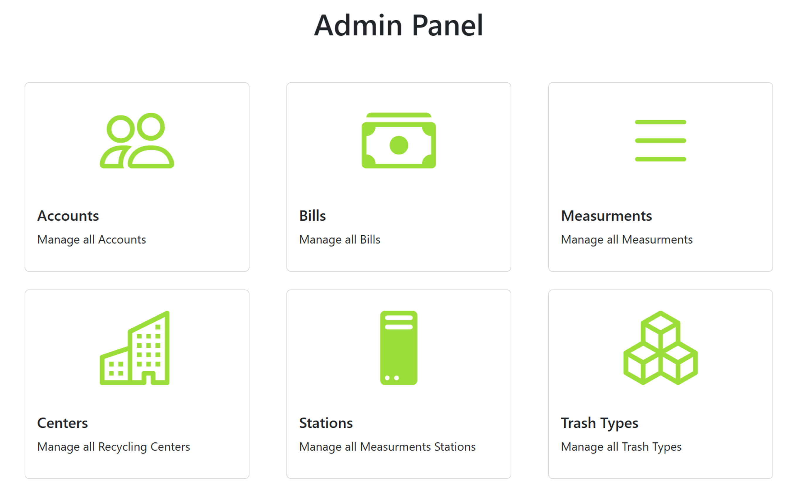
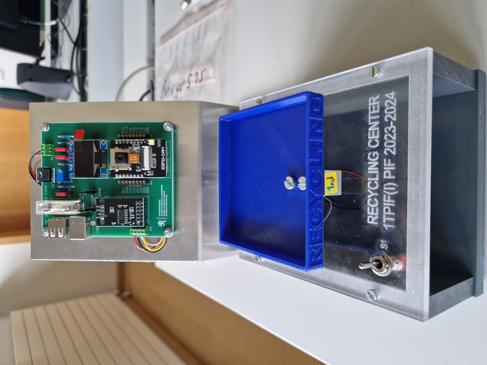
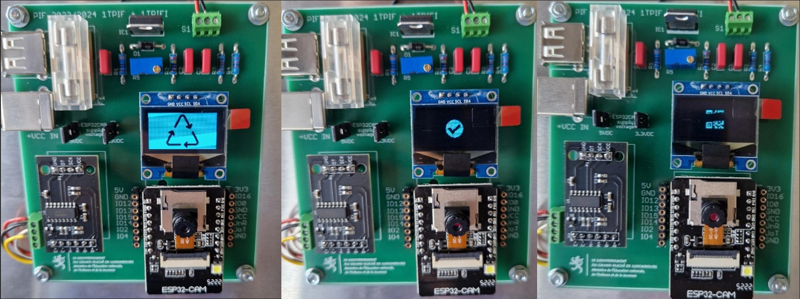

# EcoWeighing — Système de Gestion et de Pesée pour Centres de Recyclage / Smart Weighing & Management System for Recycling Centers

[**Français**](#présentation-du-projet) **| [English](#project-overview)**

# Version Française

**Projet Intégré Final (PIF) — Fin d'Études Secondaires (2023–2024)**  
*Développement Web Full-Stack, Administration Système Linux, Infrastructure Réseau, IoT (ESP32) et Conception Matérielle.*

## Présentation du Projet

**EcoWeighing** est un projet technique de fin d'études secondaires réalisé au **Lycée Guillaume Kroll (Luxembourg)** au sein de la division informatique (`1TPIF2`).

L'objectif de ce projet consiste à concevoir et déployer l'infrastructure complète d'une société fictive gérant un réseau de centres de recyclage. Lorsqu'un usager dépose des matériaux recyclables, il s'authentifie sur une borne de pesée connectée (IoT) à l'aide d'un QR Code personnel, effectue la pesée de ses déchets, et retrouve automatiquement ses mesures ainsi que ses factures sur une plateforme web dédiée.

### Synthèse des Réalisations

* **Conception de bout en bout (Software & Hardware) :** Réalisation complète allant de l'assemblage électronique et mécanique de la balance jusqu'au déploiement d'une infrastructure serveur Linux redondante et au développement d'une plateforme web.
* **Haute Disponibilité et Sécurité :** Implémentation d'une réplication de base de données MySQL **Master-Slave**, d'un système de **sauvegarde automatisée (Bash/Cron)**, d'un **Plan de Reprise d'Activité (Disaster Recovery Plan)**, du chiffrement **SSL/TLS (HTTPS)** et d'une authentification réseau sans fil **WPA2-Enterprise (RADIUS)**.
* **Développement 100 % Authentique (Sans IA) :** L'intégralité de ce projet (code source Front-End et Back-End, requêtes SQL, scripts Bash, configurations réseau, code embarqué C++ et documentation technique) a été conçue et développée de manière autonome, sans recours à aucune intelligence artificielle générative.
* **Résultats Académiques :** Obtention de la note maximale de 60/60 (100 %) sur l'ensemble du volet informatique (Laboratoire), notamment grâce à l'intégration de près de 40 fonctionnalités techniques additionnelles au cahier des charges initial.

## Architecture du Système

```
+-------------------------------------------------------------------------+
|                        INFRASTRUCTURE ECOWEIGHING                       |
+-------------------------------------------------------------------------+

  [ Client / Administrateur ]               [ Station de Pesée IoT ]
              |                                        |
     (Navigateur HTTPS)                     (Scan QR Code + Pesée)
              |                                        |
              v                                        v
  +-----------------------+                +-----------------------+
  |   VirtualHost Web     |                | VirtualHost API (PHP) |
  |   10.1.25.1 : 443     |                |   10.1.25.2 : 8081    |
  +-----------------------+                +-----------------------+
              \                                        /
               \                                      /
                v                                    v
        +----------------------------------------------------+
        |         Serveur Principal (Ubuntu / LAMP)          |
        |            Base de Données MySQL (Master)          |
        +----------------------------------------------------+
                                  |
                     (Réplication en temps réel)
                                  |
                                  v
        +----------------------------------------------------+
        |       Serveur de Réplication (10.1.25.3)           |
        |     MySQL (Slave) + Backups Quotidiens (23h00)     |
        +----------------------------------------------------+
```

## Aperçu Visuel / Visual Preview

<div align="center">
  <h3>Portail Client & Carte Interactive</h3>
  <p></p>

  <h3>Panneau d'Administration (Back-Office)</h3>
  <p></p>

  <h3>Profil Utilisateur & QR Code d'Authentification</h3>
  <p></p>

  <h3>Station de Pesée IoT (Châssis, Balance & Boîtier)</h3>
  <p></p>

  <h3>Circuit Imprimé (PCB) & Affichage OLED</h3>
  <p></p>
</div>

## Volet 1 : Ingénierie Informatique (Laboratoire)

### 1. Plateforme Web Full-Stack (`/EcoWeighing`)

Développement d'une application web dynamique et responsive (adaptée aux écrans mobiles et ordinateurs) reposant sur une architecture modulaire.

* **Technologies utilisées :** PHP 8.3, MySQLi, HTML5, CSS3, Bootstrap 5.3, JavaScript (ES6), jQuery, AJAX, DataTables, Leaflet.js, SweetAlert2.
* **Fonctionnalités Utilisateur (Front-Office) :**
  * Création de compte et authentification sécurisée (vérification de l'unicité du nom d'utilisateur et de l'adresse e-mail, persistance de session *"Remember Me"* sur 30 jours par cookies).
  * Génération dynamique et régénération à la demande d'un **QR Code personnel** (code alphanumérique unique) servant à l'authentification sur la borne physique.
  * Recherche dynamique en AJAX des centres de recyclage (par code ou localité), géolocalisation sur une **carte interactive (Leaflet.js)**, affichage des horaires et sélection d'un centre favori.
  * Consultation de l'historique des pesées et des factures via des tableaux interactifs (**DataTables**).
  * Interface de règlement des factures et système de notifications (alerte en cas de facture impayée et restriction empêchant la suppression du compte tant qu'un solde reste dû).
* **Panneau d'Administration (Back-Office) :**
  * Contrôle d'accès basé sur les rôles (redirection `401 - Unauthorized` pour les utilisateurs non autorisés, protection empêchant la modification d'un compte administrateur par un pair).
  * Opérations **CRUD complètes** via requêtes AJAX et fenêtres modales Bootstrap pour la gestion des utilisateurs, des factures, des pesées, des types de matériaux (et tarifs associés), des stations de mesure et des centres.
  * Gestion granulaire des horaires d'ouverture (support de multiples plages horaires quotidiennes par centre) et affectation des types de déchets pris en charge par chaque station.

### 2. Base de Données Relationnelle (`/Database`)

Modélisation conceptuelle (MCD) et logique (MLD) d'une base de données relationnelle normalisée sous **MySQL**.

* **Schéma (8 tables) :** `tblusers`, `tblcenters`, `tblschedules`, `tblstations`, `tblstationstype`, `tbltrashtype`, `tblmeasures`, `tblbill`.
* **Caractéristiques techniques :**
  * Table de jonction *Many-to-Many* (`tblstationstype`) permettant d'associer plusieurs catégories de matériaux à une même station de pesée.
  * Table dédiée aux plages horaires (`tblschedules`) dissociée de la table des centres pour permettre plusieurs ouvertures par jour.
  * Maintien de l'intégrité référentielle sous le moteur InnoDB via l'usage ciblé des contraintes `ON DELETE CASCADE`, `SET NULL` et `RESTRICT`.

### 3. Administration Système, Sécurité et Continuité d'Activité (`/Server_files`)

Installation, configuration et sécurisation de l'environnement serveur sous **Ubuntu Server 22.04 LTS**.

* **Réseau et Déploiement :** Configuration d'adresses IP statiques sur plusieurs interfaces réseau via `Netplan` (`enp0s3` en `10.1.25.1/16` et `enp0s8` en `10.1.25.2/16`), administration à distance via `OpenSSH`, et gestion de versions via `Git` et `GitHub CLI`.
* **Serveur Web Apache2 et Chiffrement :**
  * Séparation logique des flux via deux `VirtualHosts` : l'un dédié au portail client (`10.1.25.1:443`) et l'autre réservé à l'API du microcontrôleur (`10.1.25.2:8080` et `8081`).
  * Mise en place de certificats SSL auto-signés (`OpenSSL`) et redirection permanente du trafic `HTTP (80)` vers `HTTPS (443)`.
  * Application du principe de moindre privilège sur MySQL : création d'un compte applicatif dédié disposant uniquement des droits nécessaires sur la base `db_ecoweighing`.
* **Haute Disponibilité et Plan de Reprise d'Activité (PRA / DRP) :**
  * **Réplication MySQL Master-Slave :** Déploiement d'un serveur secondaire (`10.1.25.3`) répliquant en temps réel les écritures de la base principale (filtrage réseau sur le port `3306` via le pare-feu `UFW`).
  * **Sauvegardes Automatisées :** Script `Bash` planifié quotidiennement à 23h00 via `Crontab` sur le serveur de réplication. Exportation et compression (`.sql.gz`) de la base complète ainsi que de chaque table individuellement, avec purge automatique des archives de plus de 7 jours.
  * **Disaster Recovery Plan :** Documentation des procédures de restauration (récupération d'une table isolée, de la base complète ou reconstruction intégrale du serveur).

### 4. Infrastructure Réseau (`/Network`)

Conception et simulation de l'architecture réseau multi-sites de l'entreprise sous **Cisco Packet Tracer**.

* **Adressage et Segmentation :** Découpage en sous-réseaux selon la méthode **VLSM** à partir du bloc `192.168.99.0/24` et segmentation par VLANs (Utilisateurs, Serveurs, Management VLAN 199, Sans-fil VLAN 50).
* **Routage et Commutation :** Configuration des commutateurs de niveau 2, d'un commutateur de distribution de niveau 3, d'un routeur de bordure (*Router-on-a-Stick* avec encapsulation `dot1Q`), ainsi que des routeurs opérateur (ISP) et Internet.
* **Sécurité et Services Réseau :**
  * Traduction d'adresses **NAT/PAT (Overload)** en sortie et **Port Forwarding** (`80` et `443`) pour rendre le serveur web accessible depuis les centres externes.
  * Mise en place de listes de contrôle d'accès (**ACL**) pour restreindre le trafic entre sous-réseaux.
  * Déploiement d'un réseau sans fil d'entreprise administré par un contrôleur **WLC** et sécurisé en **WPA2-Enterprise** via un serveur d'authentification **RADIUS (AAA)**.
  * Configuration de serveurs **DNS** (interne et externe) et de relais **DHCP** (`ip helper-address`).

### 5. Système Embarqué, IoT et API (`/Controller`)

Développement du micrologiciel de la station de pesée et interfaçage avec le serveur central.

* **Composants matériels :** Microcontrôleur **ESP32-CAM** (caméra 2 MP), convertisseur analogique-numérique **HX711** relié à une cellule de charge d'une capacité de 1 kg, et afficheur **OLED 0.96" (SSD1306)**.
* **Calibration et Affichage :** Programmation en C++ (environnement Arduino) du script de tarage et détermination du facteur de calibration (`37755 / 50 g = 755.1`, arrondi à `755`). Intégration d'icônes personnalisées converties en tableaux *bitmap* (`PROGMEM`) pour illustrer les états du système sur l'écran OLED.
* **API de Communication :** Scripts PHP côté serveur permettant à l'ESP32 de valider le QR Code de l'utilisateur et de transmettre les mesures de poids à la base de données.

## Volet 2 : Ingénierie Matérielle et Électronique (Atelier)

La borne de pesée a été intégralement fabriquée, usinée et câblée en atelier :

1. **Circuits Imprimés (PCB) et Soudure :**
   * Identification des composants, vérification des résistances et assemblage par soudure de deux cartes électroniques (carte principale et interface de programmation USB-TTL).
   * Étalonnage du régulateur de tension ajustable (`LM317`) à une tension stable de 3.3 V via un potentiomètre multitours (*Spindeltrimmer*) et vérification des continuités au multimètre.
2. **Usinage PVC et Plexiglas :**
   * Traçage, pointage, perçage sur perceuse à colonne (2.5 mm et 3.5 mm), taraudage en M3 et ébavurage des éléments en PVC formant le châssis.
   * Fixation du capteur de poids et de l'interrupteur sur une plaque en plexiglas, extension du câblage et isolation par gaines thermorétractables.
3. **Travail des Métaux (Support en Aluminium) :**
   * Perçage (3.5 mm et passages de câbles de 10 mm), ébavurage et pliage à 90 degrés et 45 degrés d'une tôle d'aluminium de 2 mm d'épaisseur sur plieuse à bascule pour accueillir le circuit imprimé.
4. **Modélisation 3D et Fabrication Additive :**
   * Modélisation sous **Autodesk Tinkercad** du plateau de pesée supérieur ainsi que d'un cube d'étalonnage de 5 g.
   * Exportation au format `.stl` / `.gcode` et impression 3D en filament PLA sur une imprimante **Anycubic Kobra Go**.

## Structure du Dépôt

```
PIF-Project/
├── Controller/        # Scripts C++ (Arduino/ESP32) de calibration, ressources bitmap et API PHP
├── Database/          # Scripts SQL de création de la base de données, schémas MCD et MLD
├── Documentation/     # Documentation technique complète (98 pages), présentations et plan de reprise (DRP)
├── EcoWeighing/       # Code source de la plateforme Web (Frontend & Backend PHP/JS/CSS)
│   ├── backend/       # Scripts PHP de traitement des requêtes AJAX (CRUD administration, profil, factures)
│   ├── img/           # Ressources graphiques, logo et favicon
│   ├── inc/           # Composants modulaires (en-tête, pied de page, fenêtres modales, formulaires, vues)
│   ├── js/            # Scripts JavaScript/jQuery (validation des entrées, appels AJAX, configuration DataTables)
│   ├── index.php      # Contrôleur frontal et système de routage des pages
│   └── style.css      # Feuille de style principale et règles d'affichage adaptatif (responsive)
├── Network/           # Topologies réseau Cisco Packet Tracer (.pkt) et fichiers de configuration IOS
├── Server_files/      # Fichiers de configuration Linux (Netplan, Apache VirtualHosts, script Bash de sauvegarde)
└── README.md          # Documentation générale du dépôt (FR / EN)
```

## Déploiement Local (Plateforme Web)

Pour exécuter la plateforme web dans un environnement de développement local (LAMP, XAMPP, WAMP) :

1. **Cloner le dépôt :**
   ```bash
   git clone https://github.com/beryv/PIF-Project.git
   ```
2. **Importer la base de données :**
   * Depuis `phpMyAdmin` ou un client MySQL en ligne de commande, créer une base de données nommée `db_ecoweighing`.
   * Importer le fichier `.sql` présent dans le répertoire `/Database`.
3. **Configurer l'accès aux données :**
   * Mettre à jour les paramètres de connexion SQL dans le fichier `EcoWeighing/inc/db_params.inc.php`.
4. **Démarrer le serveur :**
   * Placer le répertoire `/EcoWeighing` à la racine du serveur HTTP (ex. `/var/www/html` ou `htdocs/`) et accéder à l'application via `http://localhost/`.

## Auteur

**Yves Bergnier**  
* Étudiant en sciences informatiques à l'École polytechnique de Louvain (UCLouvain)
* Diplômé de la section Informatique (`1TPIF2`) — **Lycée Guillaume Kroll** (Esch-sur-Alzette, Luxembourg)  
* Profil GitHub : [https://github.com/beryv](https://github.com/beryv)

*L'ensemble des schémas techniques, plans d'usinage, captures d'écran et protocoles de test est détaillé dans le document [Documentation-PIF-Final.pdf](./Documentation/PIF-Labo%20(main)/Main%20Documentation/Documentation-PIF-Final.pdf) disponible dans ce dépôt.*

---
---

# English Version

## Project Overview

**Final Integrated Project (PIF) — Secondary School Graduation Project (2023–2024)**  
*Full-Stack Web Development, Linux System Administration, Network Infrastructure, IoT (ESP32), and Hardware Engineering.*

**EcoWeighing** is a comprehensive technical capstone project completed at **Lycée Guillaume Kroll (Luxembourg)** within the Computer Science division (`1TPIF2`).

The goal of the project was to design, build, and deploy the complete technical infrastructure for a fictional company managing a network of recycling centers. When a customer drops off recyclable materials, they authenticate at a connected weighing station (IoT) using their personal QR Code, weigh their waste, and automatically access their recorded measurements and invoices on a dedicated web platform.

### Key Highlights & Achievements

* **End-to-End Engineering (Software & Hardware):** Full-lifecycle implementation ranging from PCB soldering and mechanical machining of the physical scale to deploying a redundant Linux server environment and building a full-stack web application.
* **High Availability & Security:** Implementation of **Master-Slave** MySQL database replication, an **automated backup pipeline (Bash/Cron)**, a documented **Disaster Recovery Plan (DRP)**, **SSL/TLS (HTTPS)** encryption, and **WPA2-Enterprise (RADIUS)** wireless authentication.
* **100% Authentic Development (No AI Used):** The entirety of this project—including all Front-End and Back-End source code, SQL queries, Bash scripts, network configurations, embedded C++ firmware, and technical documentation—was designed, written, and implemented independently from scratch without the use of any generative Artificial Intelligence tools.
* **Academic Excellence:** Achieved the maximum score of 60/60 (100%) across the entire IT and Software Engineering track (Laboratory), driven by the successful implementation of nearly 40 optional advanced features beyond the core specifications.

## System Architecture

```
+-------------------------------------------------------------------------+
|                        ECOWEIGHING INFRASTRUCTURE                       |
+-------------------------------------------------------------------------+

  [ Customer / Administrator ]             [ IoT Weighing Station ]
              |                                        |
       (HTTPS Browser)                        (QR Scan + Weighing)
              |                                        |
              v                                        v
  +-----------------------+                +-----------------------+
  |   Web VirtualHost     |                | API VirtualHost (PHP) |
  |   10.1.25.1 : 443     |                |   10.1.25.2 : 8081    |
  +-----------------------+                +-----------------------+
              \                                        /
               \                                      /
                v                                    v
        +----------------------------------------------------+
        |           Primary Server (Ubuntu / LAMP)           |
        |              MySQL Database (Master)               |
        +----------------------------------------------------+
                                  |
                       (Real-time replication)
                                  |
                                  v
        +----------------------------------------------------+
        |         Replication Server (10.1.25.3)             |
        |       MySQL (Slave) + Daily Backups (23:00)        |
        +----------------------------------------------------+
```

## Part 1: IT & Software Engineering (Laboratory)

### 1. Full-Stack Web Platform (`/EcoWeighing`)

Development of a dynamic, responsive web application (optimized for both desktop and mobile devices) built on a clean, modular architecture.

* **Tech Stack:** PHP 8.3, MySQLi, HTML5, CSS3, Bootstrap 5.3, JavaScript (ES6), jQuery, AJAX, DataTables, Leaflet.js, SweetAlert2.
* **Customer Portal (Front-Office):**
  * Secure account registration and authentication (enforcing unique usernames and email addresses, plus a 30-day *"Remember Me"* persistent session via cookies).
  * Dynamic generation and on-demand regeneration of a **personal QR Code** (unique alphanumeric token) used to authenticate at the physical weighing station.
  * Real-time AJAX search for recycling centers (by center code or city), interactive geolocation via **Leaflet.js**, opening hours display, and favorite center selection.
  * Detailed tracking of weighing history and invoices powered by interactive **DataTables**.
  * Online invoice payment simulation and real-time notification system (alerts for unpaid bills and account deletion prevention if an outstanding balance exists).
* **Administration Panel (Back-Office):**
  * Role-based access control (`401 - Unauthorized` redirection for non-admin users, plus safeguards preventing administrators from altering other administrator profiles).
  * **Full CRUD operations** powered by AJAX and Bootstrap modals to manage users, invoices, weighing records, waste categories (and price per kilogram), weighing stations, and recycling centers.
  * Modular schedule management (supporting multiple opening time slots per day for each center) and dynamic assignment of supported waste types per station.

### 2. Relational Database Design (`/Database`)

Design of normalized Conceptual (CDM) and Logical (LDM) Data Models implemented in **MySQL**.

* **Schema (8 tables) :** `tblusers`, `tblcenters`, `tblschedules`, `tblstations`, `tblstationstype`, `tbltrashtype`, `tblmeasures`, `tblbill`.
* **Technical Features:**
  * *Many-to-Many* associative table (`tblstationstype`) allowing individual stations to measure multiple types of recyclable materials.
  * Dedicated schedules table (`tblschedules`) decoupled from the centers table to support multiple daily operating shifts.
  * Strict referential integrity enforced via InnoDB foreign key constraints (`ON DELETE CASCADE`, `SET NULL`, and `RESTRICT`).

### 3. System Administration, Security & Business Continuity (`/Server_files`)

Deployment, configuration, and hardening of the server infrastructure running **Ubuntu Server 22.04 LTS**.

* **Networking & Deployment:** Static multi-interface IP configuration using `Netplan` (`enp0s3` at `10.1.25.1/16` and `enp0s8` at `10.1.25.2/16`), secure remote administration via `OpenSSH`, and source code deployment using `Git` and `GitHub CLI`.
* **Apache2 Web Server & SSL/TLS:**
  * Service isolation across two distinct `VirtualHosts`: one serving the main customer portal (`10.1.25.1:443`) and another dedicated to the microcontroller API (`10.1.25.2:8080` & `8081`).
  * Traffic encryption using self-signed SSL certificates (`OpenSSL`) with permanent `HTTP (80)` to `HTTPS (443)` redirection.
  * Principle of least privilege applied to MySQL: creation of a restricted database user specifically scoped to `db_ecoweighing` for web application queries.
* **High Availability & Disaster Recovery (DRP):**
  * **MySQL Master-Slave Replication:** Configuration of a secondary server (`10.1.25.3`) replicating all transactions from the primary database in real time (with port `3306` explicitly restricted via the `UFW` firewall).
  * **Automated Backups:** Custom `Bash` script scheduled daily at 23:00 via `Crontab` sur le serveur de réplication. It generates compressed archives (`.sql.gz`) of both the entire database and individual tables, enforcing an automated 7-day retention policy.
  * **Disaster Recovery Plan:** Comprehensive step-by-step documentation covering single-table recovery, full database restoration, and complete server reconstruction.

### 4. Network Infrastructure (`/Network`)

Design and simulation of the company's multi-site network architecture using **Cisco Packet Tracer**.

* **Addressing & Segmentation:** Optimal **VLSM** subnetting derived from the `192.168.99.0/24` block and logical segmentation across multiple VLANs (Users, Servers, Management VLAN 199, Wireless VLAN 50).
* **Routing & Switching:** Configuration of Layer 2 access switches, a Layer 3 distribution switch, an edge router (*Router-on-a-Stick* using `dot1Q` trunking), as well as ISP and Internet backbone routers.
* **Network Security & Services:**
  * Outbound **NAT/PAT (Overload)** address translation and **Port Forwarding** (`80` and `443`) to expose the internal web server to remote recycling centers.
  * Traffic filtering via **Access Control Lists (ACLs)** to isolate restricted network segments.
  * Enterprise wireless network managed by a **Wireless LAN Controller (WLC)** and secured with **WPA2-Enterprise** authentication via a **RADIUS (AAA)** server.
  * Split internal/external **DNS** servers and **DHCP** relay agents (`ip helper-address`).

### 5. Embedded Systems, IoT & API (`/Controller`)

Firmware development for the weighing station microcontroller and integration with the central server.

* **Hardware Components:** **ESP32-CAM** microcontroller (2 MP camera module), **HX711** analog-to-digital converter paired with a 1 kg load cell, and a **0.96" OLED display (SSD1306)**.
* **Calibration & User Interface:** C++ (Arduino framework) calibration firmware developed to tare the scale and compute the exact calibration factor (`37755 / 50 g = 755.1`, rounded to `755`). Integration of custom status icons converted into `PROGMEM` bitmap arrays rendered on the OLED screen.
* **Backend API:** Server-side PHP endpoints enabling the ESP32 to authenticate scanned QR Codes and log weight measurements directly into the MySQL database.

## Part 2: Hardware & Electronics Engineering (Workshop)

The physical weighing station was entirely manufactured, machined, and assembled in the workshop from raw materials and discrete electronic components:

1. **Printed Circuit Boards (PCB) & Electronics:**
   * Component sorting, resistor color-code verification, and through-hole soldering of two custom PCBs (main control board and USB-TTL programming board).
   * Precision tuning of the adjustable voltage regulator (`LM317`) to a stable 3.3 V output using a multi-turn trimmer potentiometer (*Spindeltrimmer*), followed by multimeter continuity testing.
2. **PVC & Plexiglas Machining:**
   * Layout marking, center punching, pillar drilling (2.5 mm and 3.5 mm drill bits), M3 thread tapping, and deburring of the structural PVC base and side plates.
   * Mounting of the 1 kg load cell and toggle switch onto an engraved plexiglas front panel, including wire extension and heat-shrink tubing insulation.
3. **Metalworking (Aluminum Bracket):**
   * Drilling (3.5 mm mounting holes and 10 mm cable pass-throughs), deburring, and precision bending at 90 degrees and 45 degrees of a 2 mm aluminum sheet using a manual box and pan brake to support the main PCB.
4. **3D CAD Modeling & Additive Manufacturing:**
   * 3D modeling in **Autodesk Tinkercad** of the custom weighing tray (featuring embossed *"RECYCLING"* lettering) and a 5 g calibration test cube (*"PLASTIC"*).
   * Slicing to `.gcode` and 3D printing using PLA filament on an **Anycubic Kobra Go** printer.

## Repository Structure

```
PIF-Project/
├── Controller/        # C++ (Arduino/ESP32) calibration sketches, bitmap assets, and controller PHP API
├── Database/          # SQL database dump files, Conceptual (CDM) and Logical (LDM) schemas
├── Documentation/     # Full 98-page technical documentation, presentations, and Disaster Recovery Plan
├── EcoWeighing/       # Complete source code for the Web Platform (Frontend & Backend PHP/JS/CSS)
│   ├── backend/       # AJAX PHP endpoints (admin CRUD operations, user profile, billing, search)
│   ├── img/           # Brand assets, logos, and favicon
│   ├── inc/           # Modular PHP includes (header, footer, Bootstrap modals, forms, DB config, views)
│   ├── js/            # JavaScript/jQuery scripts (input validation, AJAX requests, DataTables config)
│   ├── index.php      # Front controller and page routing engine
│   └── style.css      # Custom stylesheet and responsive design rules
├── Network/           # Cisco Packet Tracer (.pkt) network topologies and IOS configuration files
├── Server_files/      # Linux configuration files (Netplan, Apache VirtualHosts, Bash backup script)
└── README.md          # Bilingual project documentation (FR / EN)
```

## Local Deployment (Web Platform)

To deploy and test the web application locally (using a LAMP stack, XAMPP, or WAMP):

1. **Clone the repository:**
   ```bash
   git clone https://github.com/beryv/PIF-Project.git
   ```
2. **Importer la base de données :**
   * Open `phpMyAdmin` or your MySQL CLI client and create a new database named `db_ecoweighing`.
   * Import the `.sql` file located in the `/Database` directory.
3. **Configure database credentials:**
   * Verify or update the SQL connection parameters in `EcoWeighing/inc/db_params.inc.php`.
4. **Launch the application:**
   * Copy the contents of the `/EcoWeighing` folder into your web server's document root (e.g., `/var/www/html` or `htdocs/`) and navigate to `http://localhost/`.

## Author

**Yves Bergnier**  
* Student in Computer Science at Louvain School of Engineering (UCLouvain)
* Computer Science Graduate (`1TPIF2`) — **Lycée Guillaume Kroll** (Esch-sur-Alzette, Luxembourg)  
* GitHub Profile: [https://github.com/beryv](https://github.com/beryv)

*For complete technical diagrams, machining blueprints, test protocols, and configuration screenshots, please refer to the full [Documentation-PIF-Final.pdf](./Documentation/PIF-Labo%20(main)/Main%20Documentation/Documentation-PIF-Final.pdf) file included in this repository.*
